# 👩🏻‍💻 Gabriel Braga Siebra

**`Desenvolvedor Automações n8n, js e python`**

Me chamo  GabrieL Braga Siebra, tenho 24 anos e sou natural de Fortelza ce. sou Aluno de Redes de Computadores na Universidade Ateneu sou apaixonado pelo mercado de tecnologia , com foco e constante aprendizado voltado no setor de automações em N8N, estou estudando python e também tenho experiencia no setor de Suporte técnico ao Usuário presencial e remoto (Helpdesk).Possuo foco e comprometimento nas atividades do dia a dia , facilidade em comunicação remota com usuários e clientes dentro da organização , bom em atividades interpessoais , curiosidade em novas tecnologias sempre em constante aprendizado buscando novas experiências tanto como pessoais e profissionais , analítico , autodidata , procuro sempre desenvolver soluções rápidas assertivas.

---

### 🤖 Linguagens e Tecnologias

 
 

### 📊 Estatísticas

  

### 📊 Estatísticas

  

  

